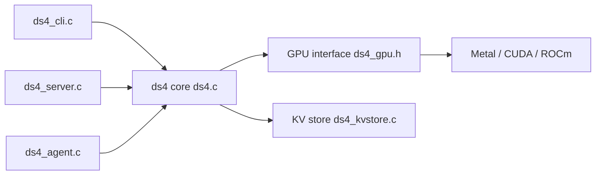

# antirez/ds4

> Moteur d'inférence natif étroit pour quelques LLM (DeepSeek V4, GLM, Qwen) sur machines personnelles.

## Le problème
Faire tourner de grands modèles ouverts sur du matériel grand public demande des moteurs généraux difficiles à optimiser pour un modèle précis.

## Ce que ça fait vraiment
Moteur en C (`ds4.c`) avec backends Metal, CUDA et ROCm, qui ne lit que les GGUF du projet. Livre un CLI, un serveur HTTP compatible OpenAI et Anthropic (`ds4-server`), un agent de code natif et une suite d'évaluation. Streaming depuis le SSD, cache KV sur disque, parallélisme tensoriel sur deux Mac en RDMA. Développé « avec une forte assistance d'agents IA », ce que le README dit ouvertement.

## Comment c'est branché


## Essayer
```bash
git clone https://github.com/antirez/ds4.git
cd ds4
make
./download_model.sh ds4f-q2
./ds4 -p "Explain Redis streams in one paragraph."
```

## Coût et pièges
Machine de 96 à 128 Go recommandée pour Flash Q2 ; sinon streaming SSD rapide. Les fichiers GGUF font plus de 100 Go pour certains modèles. Le README parle d'une qualité bêta avec régressions possibles.

## Ce que ce n'est pas
Pas un exécuteur GGUF général. Les chiffres de vitesse sont une base mesurée sur un M5 Max, pas un benchmark de chaque commit.

## Alternatives
llama.cpp et GGML (cités en remerciements comme base du projet).

## Pour toi
À surveiller : intéressant pour l'inférence locale de gros modèles sur Apple Silicon ou DGX Spark, mais matériel exigeant et instable.

