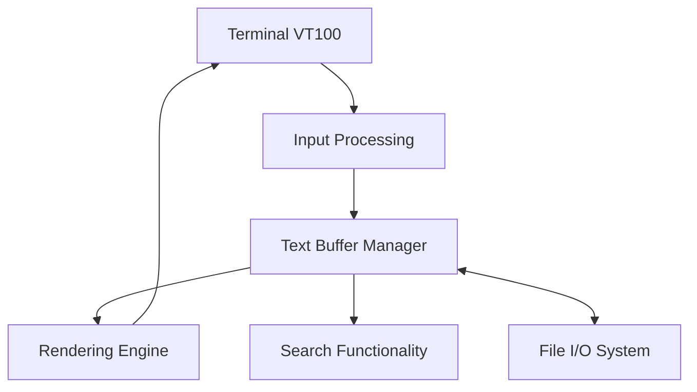

# antirez/kilo

> Minimal terminal text editor in under a thousand lines of C, for learning.

## The problem
Terminal editors rely on heavy libraries and their code is hard to read.

## What it actually does
A single-file C editor, with no dependencies, not even curses, using VT100 escape sequences. Shortcuts: CTRL-S saves, CTRL-Q quits, CTRL-F searches. The author presents it as a starting point for other editors or command-line interfaces. Alpha stage.

## How it is wired


## Trying it
```bash
# Usage indiqué dans le README : kilo <fichier>
# Aucune commande de compilation documentée.
```

## Cost and gotchas
Free. A C compiler is required, absent from the listed prerequisites. Last push in January 2025: practically frozen project.

## What it is not
Not a full editor: alpha stage, minimal features. The diagrams provided describe a monolithic single-file editor.

## Alternatives
No alternative named in the README.

## For you
Ignore as a work tool: worth reading if you want to understand how a terminal editor works in little code.
