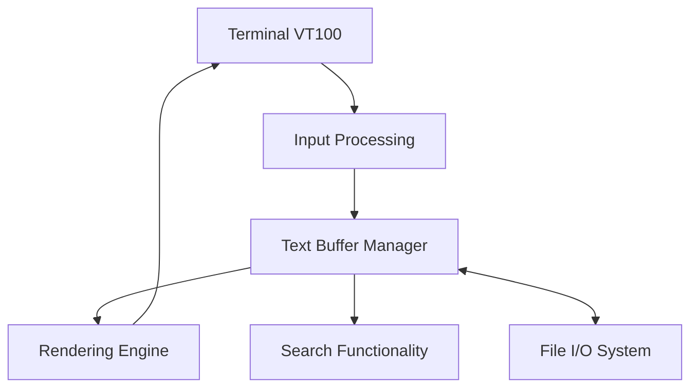

# antirez/kilo

> Éditeur de texte minimal en terminal, en moins de mille lignes de C, pour apprendre.

## Le problème
Les éditeurs en terminal passent par des bibliothèques lourdes et leur code est difficile à lire.

## Ce que ça fait vraiment
Éditeur en un seul fichier C, sans dépendance, même pas curses, qui utilise les séquences d'échappement VT100. Raccourcis : CTRL-S enregistre, CTRL-Q quitte, CTRL-F cherche. L'auteur le présente comme un point de départ pour d'autres éditeurs ou interfaces en ligne de commande. Phase alpha.

## Comment c'est branché


## Essayer
```bash
# Usage indiqué dans le README : kilo <fichier>
# Aucune commande de compilation documentée.
```

## Coût et pièges
Gratuit. Un compilateur C est nécessaire, absent des prérequis listés. Dernier push en janvier 2025 : projet quasi figé.

## Ce que ce n'est pas
Pas un éditeur complet : phase alpha, fonctions minimales. Les diagrammes fournis décrivent un éditeur monolithique en un fichier.

## Alternatives
Aucune alternative nommée dans le README.

## Pour toi
À ignorer comme outil de travail : à lire si tu veux comprendre comment un éditeur de terminal fonctionne en peu de code.

