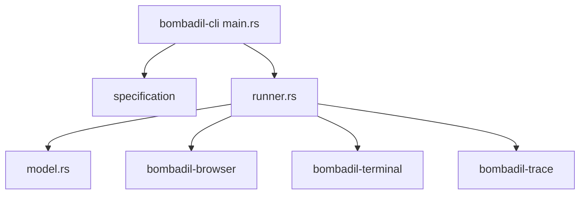

# antithesishq/bombadil

> Property-based testing for web and terminal interfaces: explores the UI on its own and checks correctness properties.

## The problem
Hand-written tests do not cover the unlikely paths of an interface; rare bugs slip into production.

## What it actually does
Loads a user specification, generates actions on a UI (browser via Chrome DevTools, or terminal via PTY), evaluates temporal properties, records traces and can shrink a failing trace. An inspection interface displays the timeline. Runs locally, in CI or in Antithesis. Several links between crates are unconfirmed.

## How it is wired
Diagram based on the code diagram.



## Trying it
```bash
# README : aucune commande, voir le manuel (installation et exemples en ligne).
```

## Cost and gotchas
Free, MIT. A young project (created in December 2025) and the installation docs are external. Contributions go through issues and Discord, with a policy on generative AI.

## What it is not
Not an API or load testing tool. It drives an interface, not a service.

## Alternatives
No alternative named in the README.

## For you
Worth watching: an interesting idea for testing AI application interfaces, still experimental and thinly documented in the README.
