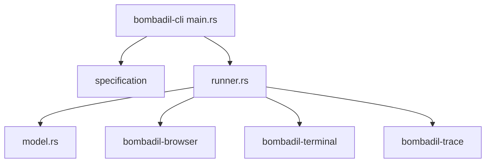

# antithesishq/bombadil

> Test par propriétés pour interfaces web et terminal : explore l'UI seul et vérifie des propriétés de correction.

## Le problème
Les tests écrits à la main ne couvrent pas les chemins improbables d'une interface ; les bugs rares passent en production.

## Ce que ça fait vraiment
Charge une spécification utilisateur, génère des actions sur une UI (navigateur via Chrome DevTools, ou terminal via PTY), évalue des propriétés temporelles, enregistre des traces et sait réduire une trace en échec. Une interface d'inspection affiche la chronologie. Tourne en local, en CI ou dans Antithesis. Plusieurs liaisons entre crates ne sont pas confirmées.

## Comment c'est branché
Schéma d'après le diagramme du code.



## Essayer
```bash
# README : aucune commande, voir le manuel (installation et exemples en ligne).
```

## Coût et pièges
Gratuit, MIT. Projet jeune (créé en décembre 2025) et la doc d'installation est externe. Les contributions passent par issues et Discord, avec une politique sur l'IA générative.

## Ce que ce n'est pas
Pas un outil de test d'API ni de charge. Il pilote une interface, pas un service.

## Alternatives
Aucune alternative nommée dans le README.

## Pour toi
À surveiller : idée intéressante pour tester des interfaces d'applications IA, encore expérimentale et peu documentée dans le README.

