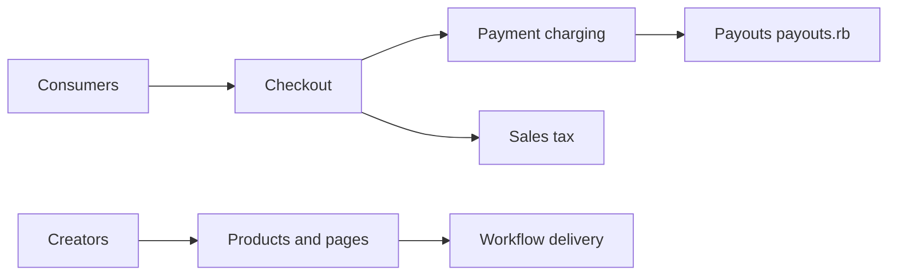

# antiwork/gumroad

> Source code of the Gumroad platform, where creators sell digital products, for Rails developers.

## The problem
Selling digital products requires payment, taxes, payouts, audience messaging and file delivery.

## What it actually does
Rails application with Sidekiq, MySQL 8.4, Redis, Elasticsearch, Docker for local services. Visible areas: checkout and payment, payouts to sellers, sales tax, product reviews, workflows and audience messages. Required system tools: ImageMagick, FFmpeg, pdftk, wkhtmltopdf.

## How it is wired


## Trying it
```bash
make local
bin/rails db:prepare
bin/dev
bin/rspec
```

## Cost and gotchas
Free locally. Stripe, S3, Resend require credentials. Apple Pay and cross-subdomain cookies do not work locally. Many prerequisites (MySQL, Percona, wkhtmltopdf 0.12.6).

## What it is not
Not a ready-to-deploy kit for your own shop: the README only describes the development environment.

## Alternatives
No alternative named in the README.

## For you
Ignore: Rails business application unrelated to data or AI; useful only as code reading.
