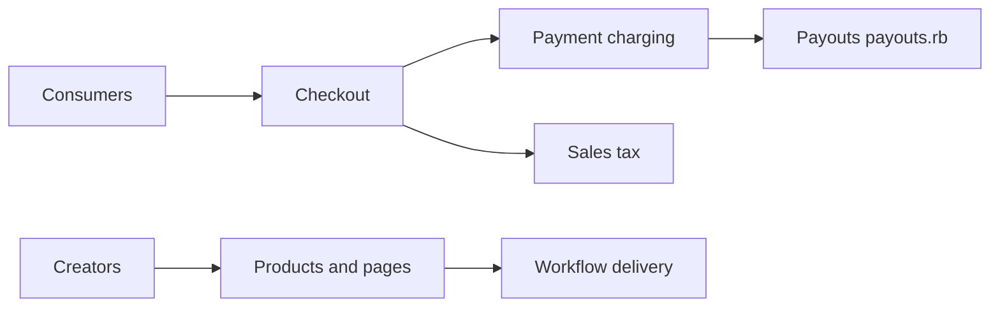

# antiwork/gumroad

> Code source de la plateforme Gumroad, où des créateurs vendent des produits numériques, pour développeurs Rails.

## Le problème
Vendre des produits numériques exige paiement, taxes, versements, messagerie d'audience et livraison de fichiers.

## Ce que ça fait vraiment
Application Rails avec Sidekiq, MySQL 8.4, Redis, Elasticsearch, Docker pour les services locaux. Zones visibles : checkout et paiement, versement aux vendeurs, taxe de vente, avis produit, workflows et messages d'audience. Outils système requis : ImageMagick, FFmpeg, pdftk, wkhtmltopdf.

## Comment c'est branché


## Essayer
```bash
make local
bin/rails db:prepare
bin/dev
bin/rspec
```

## Coût et pièges
Gratuit en local. Stripe, S3, Resend nécessitent des identifiants. Apple Pay et cookies inter-sous-domaines ne marchent pas en local. Prérequis nombreux (MySQL, Percona, wkhtmltopdf 0.12.6).

## Ce que ce n'est pas
Pas un kit prêt à déployer pour ta propre boutique : le README ne décrit que l'environnement de développement.

## Alternatives
Aucune alternative nommée dans le README.

## Pour toi
À ignorer : application métier Rails sans rapport avec la data ou l'IA ; utile seulement comme lecture de code.

