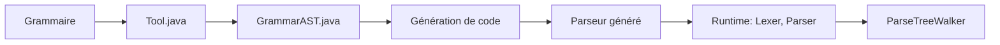

# antlr/antlr4

> Parser generator that produces parsers and trees from a grammar, in ten target languages.

## The problem
Reading, transforming or executing a structured format (JSON, protocol, DSL, macro) requires writing a parser by hand.

## What it actually does
From a grammar, ANTLR generates a lexer and parser that build a parse tree, plus a listener or visitor interface to react to recognized phrases. The architecture describes the chain: grammar AST, transformation, semantic analysis, ATN analysis, code generation, then execution (lexer, token stream, parser, ATN simulator, tree walking, XPath). Ten targets: C++, C#, Dart, Java, JavaScript, PHP, Python3, Swift, TypeScript, Go.

## How it is wired


## Trying it
```bash
go get github.com/antlr4-go/antlr
```
The README points to the documentation and the "Getting started" guide; no other command appears in it.

## Cost and gotchas
Free, BSD-3-Clause. Versioning is not semver: minor versions can break compatibility, and parsers must be regenerated with each version. Python 2 is no longer supported since 4.14. The Go runtime is fetched from a dedicated repository.

## What it is not
Not a ready-to-use parser: you must write or obtain a grammar. The grammars in the repository have no actions.

## Alternatives
None named in the README, apart from ANTLR v3 (the previous version).

## For you
Worth watching: useful if you need to parse a custom language or format (queries, pipeline DSL), with Python and Java targets; otherwise useless for pure ML.
