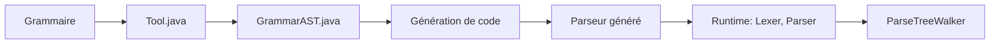

# antlr/antlr4

> Générateur d'analyseurs syntaxiques qui produit parseurs et arbres à partir d'une grammaire, en dix langages cibles.

## Le problème
Lire, transformer ou exécuter un format structuré (JSON, protocole, DSL, macro) demande d'écrire un analyseur à la main.

## Ce que ça fait vraiment
À partir d'une grammaire, ANTLR génère un analyseur lexical et syntaxique qui construit un arbre d'analyse, et une interface listener ou visitor pour réagir aux phrases reconnues. L'architecture décrit la chaîne : AST de grammaire, transformation, analyse sémantique, analyse ATN, génération de code, puis exécution (lexer, flux de tokens, parser, simulateur ATN, parcours d'arbre, XPath). Dix cibles : C++, C#, Dart, Java, JavaScript, PHP, Python3, Swift, TypeScript, Go.

## Comment c'est branché


## Essayer
```bash
go get github.com/antlr4-go/antlr
```
Le README renvoie vers la documentation et le « Getting started » ; aucune autre commande n'y figure.

## Coût et pièges
Gratuit, BSD-3-Clause. Le versionnage n'est pas semver : les versions mineures peuvent casser la compatibilité, il faut régénérer les parseurs à chaque version. Python 2 n'est plus pris en charge depuis la 4.14. Le runtime Go se récupère via un dépôt dédié.

## Ce que ce n'est pas
Pas un parseur prêt à l'emploi : il faut écrire ou récupérer une grammaire. Les grammaires du dépôt n'ont pas d'actions.

## Alternatives
Aucune nommée dans le README, hors ANTLR v3 (version précédente).

## Pour toi
À surveiller : utile si tu dois parser un langage ou un format maison (requêtes, DSL de pipeline), avec des cibles Python et Java ; sinon inutile pour du ML pur.

