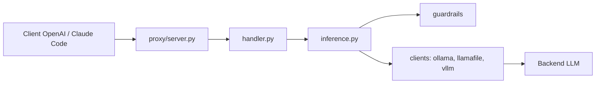

# antoinezambelli/forge

> Reliability layer for tool calling in self-hosted LLMs: validation, repair and retry.

## The problem
Small local models call tools poorly: broken format, unknown tool, skipped steps.

## What it actually does
Three uses: an OpenAI- and Anthropic-compatible proxy (`/v1/messages`), a `WorkflowRunner` for a managed agent loop, or a guardrails middleware. The proxy validates each tool call, extracts badly formatted calls (rescue parsing), and retries with a corrective message up to `--max-retries` (3 by default). Backends: llama-server, Ollama, Llamafile, vLLM, Anthropic. The README claims 84% on its suite of 26 scenarios for an 8B model (author's measurement).

## How it is wired


## Trying it
```bash
pip install forge-guardrails
llama-server -m path/to/Ministral-3-8B-Instruct-2512-Q8_0.gguf --jinja -ngl 999 --port 8080
python -m forge.proxy --backend-url http://localhost:8080 --backend llamaserver --port 8081
```

## Cost and gotchas
Python 3.12+ and a local LLM backend (GPU useful). The proxy does not authenticate callers; it does not compact history and does not enforce step order.

## What it is not
Not a multi-agent orchestrator nor a code harness: it makes a single tool loop reliable.

## Alternatives
- opencode, aider, Cline: clients that the proxy strengthens, not competitors.

## For you
Adopt if you run local models with tools: the proxy slots in without rewriting your client.
