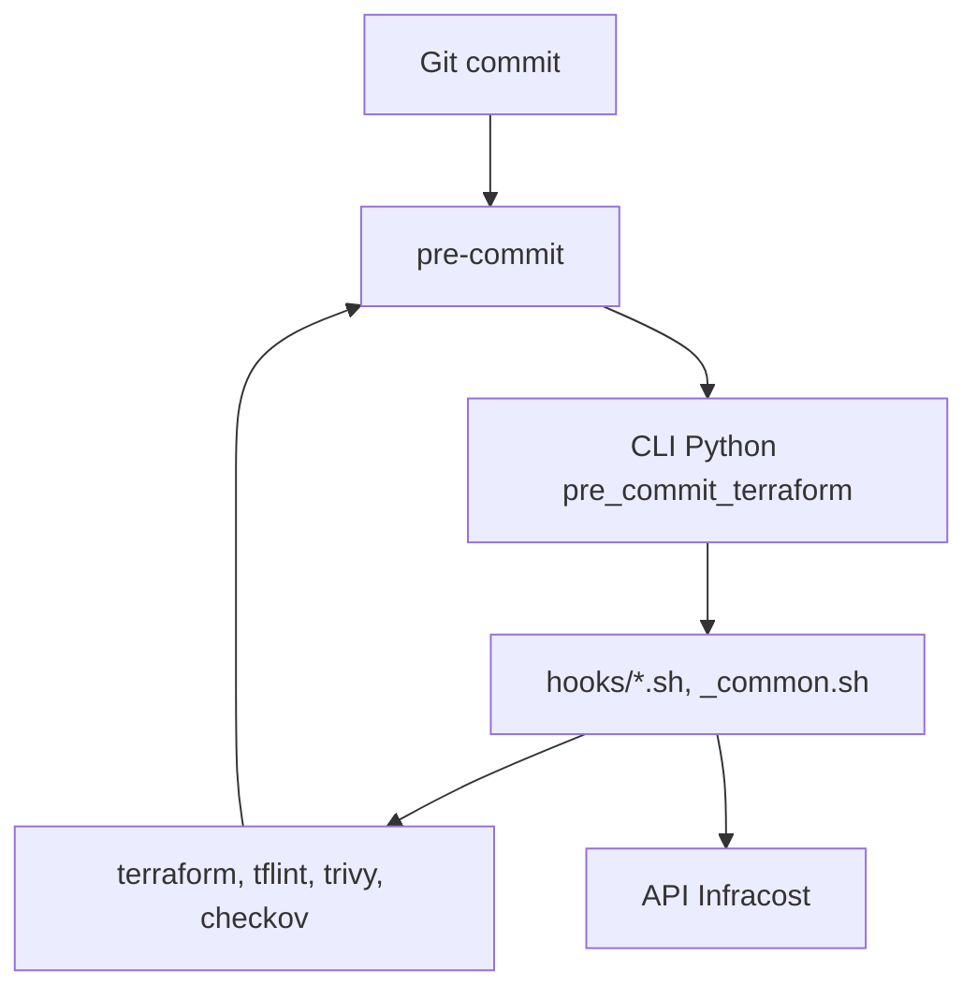

# antonbabenko/pre-commit-terraform

> Collection of pre-commit git hooks for Terraform, OpenTofu and Terragrunt, for infra teams.

## The problem
Badly formatted, invalid or undocumented Terraform code reaches review; manual checks get forgotten.

## What it actually does
Provides hooks for pre-commit: `terraform_fmt`, `terraform_validate`, `terraform_docs`, `terraform_tflint`, `terraform_trivy`, `terraform_checkov`, `infracost_breakdown`, `tfupdate`, and Terragrunt equivalents. Each hook is a shell script called by a Python CLI. A hook can pin a tool's version. The whole can run locally, in CI or in a Docker image.

## How it is wired


## Trying it
```bash
docker pull ghcr.io/antonbabenko/pre-commit-terraform:latest
pre-commit init-templatedir -t pre-commit ~/.git-template
pre-commit run -a
docker run -e "USERID=$(id -u):$(id -g)" -v "$(pwd):/lint" -w "/lint" ghcr.io/antonbabenko/pre-commit-terraform:latest run -a
```
You need a `.pre-commit-config.yaml` listing the desired hooks.

## Cost and gotchas
Free. The `infracost_breakdown` tool requires an Infracost API key. Each hook needs its binary installed (or the Docker image). Windows: WSL recommended.

## What it is not
Not a deployment tool: it checks code before commit. Files deleted with no other change in the folder escape the checks.

## Alternatives
- No alternative named in the README.

## For you
Adopt if you manage Terraform infrastructure for your MLOps platform: a systematic check before commit prevents configuration errors, for a low installation cost.
