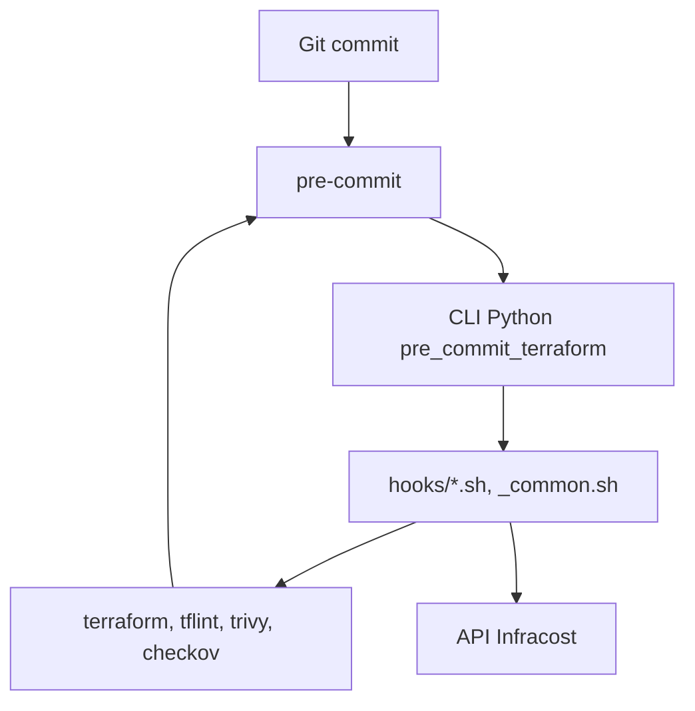

# antonbabenko/pre-commit-terraform

> Collection de hooks git pre-commit pour Terraform, OpenTofu et Terragrunt, pour équipes infra.

## Le problème
Du code Terraform mal formaté, invalide ou non documenté arrive en revue ; les contrôles manuels sont oubliés.

## Ce que ça fait vraiment
Fournit des hooks pour pre-commit : `terraform_fmt`, `terraform_validate`, `terraform_docs`, `terraform_tflint`, `terraform_trivy`, `terraform_checkov`, `infracost_breakdown`, `tfupdate`, et des équivalents Terragrunt. Chaque hook est un script shell appelé par un CLI Python. Un hook peut épingler la version d'un outil. L'ensemble peut tourner en local, en CI ou dans une image Docker.

## Comment c'est branché


## Essayer
```bash
docker pull ghcr.io/antonbabenko/pre-commit-terraform:latest
pre-commit init-templatedir -t pre-commit ~/.git-template
pre-commit run -a
docker run -e "USERID=$(id -u):$(id -g)" -v "$(pwd):/lint" -w "/lint" ghcr.io/antonbabenko/pre-commit-terraform:latest run -a
```
Il faut un `.pre-commit-config.yaml` listant les hooks voulus.

## Coût et pièges
Gratuit. L'outil `infracost_breakdown` exige une clé d'API Infracost. Chaque hook demande son binaire installé (ou l'image Docker). Windows : WSL recommandé.

## Ce que ce n'est pas
Pas un outil de déploiement : il contrôle le code avant commit. Les fichiers supprimés sans autre modification dans le dossier échappent aux contrôles.

## Alternatives
- Aucune alternative nommée dans le README.

## Pour toi
À adopter si tu gères de l'infra Terraform pour ta plateforme MLOps : un contrôle systématique avant commit évite des erreurs de configuration, pour un coût d'installation faible.

