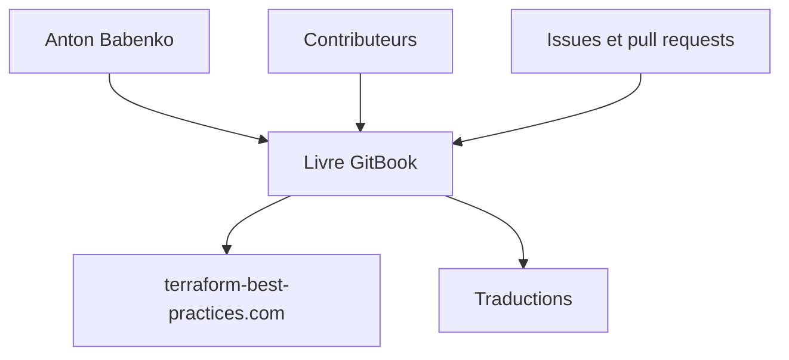

# antonbabenko/terraform-best-practices

> Online book of Terraform best practices, for anyone managing infrastructure as code.

## The problem
Terraform lets you do anything, including organizations that are hard to maintain; teams run into the same problems.

## What it actually does
A collection of systematic recommendations, updated for Terraform 1.0, readable at terraform-best-practices.com. Markers distinguish established advice from opinionated choices. Translated into about twenty languages including French. The chapters themselves are not in the README provided.

## How it is wired
Simplified diagram based on the fiche, no diagram provided.

## Trying it
No command: read online at https://www.terraform-best-practices.com/.

## Cost and gotchas
Free. License not identified by GitHub. The content is the author's opinion: some recommendations remain preferences.

## What it is not
Not a tool or a Terraform module. It contains no executable code according to the README.

## Alternatives
No alternative named in the README.

## For you
Adopt: free reading, directly useful for structuring the infrastructure of an MLOps platform, taking care to verify the license before reusing any text.
