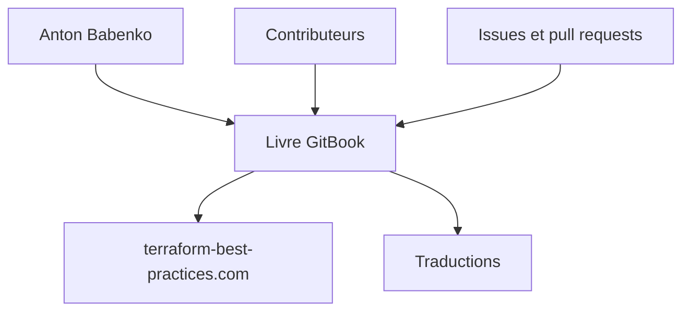

# antonbabenko/terraform-best-practices

> Livre en ligne de bonnes pratiques Terraform, pour qui gère l'infrastructure en code.

## Le problème
Terraform laisse tout faire, y compris des organisations difficiles à maintenir ; les équipes butent sur les mêmes problèmes.

## Ce que ça fait vraiment
Recueil de recommandations systématiques, mis à jour pour Terraform 1.0, lisible sur terraform-best-practices.com. Des indications marquent les conseils établis par opposition aux choix d'opinion. Traduit en une vingtaine de langues dont le français. Les chapitres eux-mêmes ne figurent pas dans le README fourni.

## Comment c'est branché
Schéma simplifié d'après la fiche, sans diagramme fourni.

## Essayer
Aucune commande : lire en ligne sur https://www.terraform-best-practices.com/.

## Coût et pièges
Gratuit. Licence non identifiée par GitHub. Le contenu est un avis d'auteur : certaines recommandations restent des préférences.

## Ce que ce n'est pas
Ce n'est pas un outil ni un module Terraform. Il ne contient pas de code exécutable d'après le README.

## Alternatives
Aucune alternative nommée dans le README.

## Pour toi
À adopter : lecture gratuite et directement utile pour structurer l'infrastructure d'une plateforme MLOps, avec la précaution de vérifier la licence avant de reprendre du texte.

