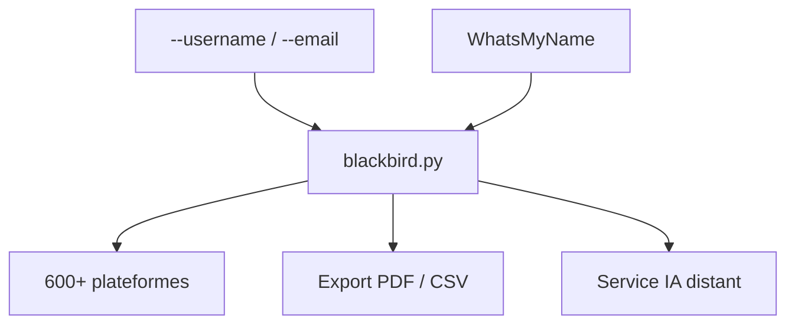

# antoniaci/blackbird

> Command-line tool that searches for a username or email across 600+ platforms, for open-source investigations.

## The problem
Finding out where a username or email address is used forces you to test each site by hand.

## What it actually does
Queries 600+ sites from the WhatsMyName list to find an account linked to a username or email. Exports to PDF or CSV. A free AI option sends the names of the sites found to a remote service to produce a behavioral profile.

## How it is wired
Simplified diagram based on the fiche, no diagram provided.



## Trying it
```bash
git clone https://github.com/p1ngul1n0/blackbird
cd blackbird
pip install -r requirements.txt
python blackbird.py --username johndoe
python blackbird.py --email johndoe@example.com --pdf
python blackbird.py --setup-ai
python blackbird.py --username johndoe --ai
```

## Cost and gotchas
Free, with a daily limit for the AI and a key to generate. No license is declared. The README specifies educational use and with authorization only.

## What it is not
Not an evidence tool: it relies on the WhatsMyName list and its possible false positives. Profiling a person without consent raises legal and ethical issues.

## Alternatives
No alternative named in the README (WhatsMyName is the data source).

## For you
Ignore: intelligence tool about people, outside your data, AI or MLOps scope, with no clear license.
