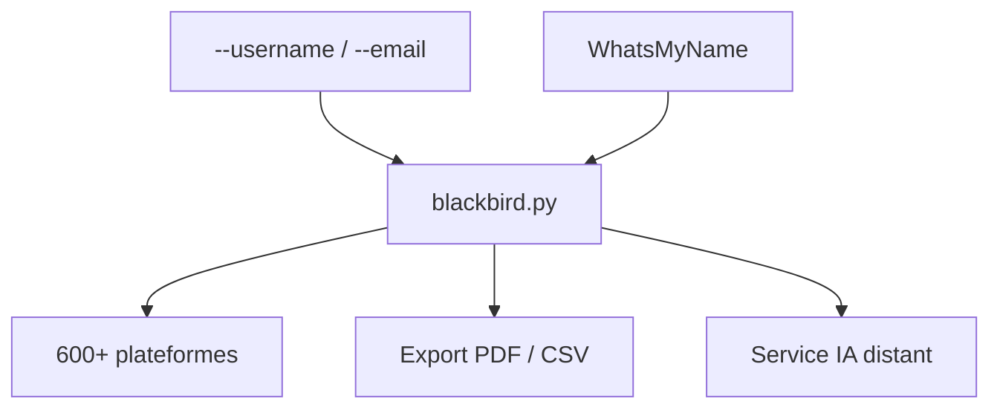

# antoniaci/blackbird

> Outil en ligne de commande qui cherche un pseudo ou un e-mail sur plus de 600 plateformes, pour enquêtes de sources ouvertes.

## Le problème
Savoir où un pseudo ou une adresse e-mail est utilisé oblige à tester chaque site à la main.

## Ce que ça fait vraiment
Interroge plus de 600 sites à partir de la liste WhatsMyName pour trouver un compte lié à un pseudo ou un e-mail. Exporte en PDF ou CSV. Une option IA gratuite envoie les noms des sites trouvés à un service distant pour produire un profil comportemental.

## Comment c'est branché
Schéma simplifié d'après la fiche, sans diagramme fourni.



## Essayer
```bash
git clone https://github.com/p1ngul1n0/blackbird
cd blackbird
pip install -r requirements.txt
python blackbird.py --username johndoe
python blackbird.py --email johndoe@example.com --pdf
python blackbird.py --setup-ai
python blackbird.py --username johndoe --ai
```

## Coût et pièges
Gratuit, avec une limite quotidienne pour l'IA et une clé à générer. Aucune licence n'est déclarée. Le README précise un usage éducatif et avec autorisation uniquement.

## Ce que ce n'est pas
Pas un outil de preuve : il repose sur la liste WhatsMyName et ses faux positifs possibles. Profiler une personne sans accord pose un problème légal et éthique.

## Alternatives
Aucune alternative nommée dans le README (WhatsMyName est la source des données).

## Pour toi
À ignorer : outil de renseignement sur des personnes, hors de ton périmètre data, IA ou MLOps, sans licence claire.

