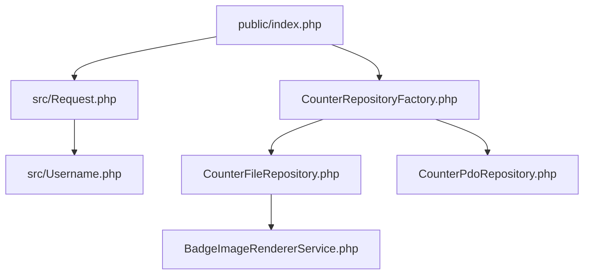

# antonkomarev/github-profile-views-counter

> GitHub profile view counter badge, hosted for free, to customize a profile README.

## The problem
GitHub does not show how many times your profile is viewed.

## What it actually does
A dynamic image from the komarev.com service counts the requests received from GitHub's image proxy (Camo) and displays the total. Options: color, style, label, starting number, abbreviation. The README states that it is a proof of concept: it counts page loads, not unique visitors.

## How it is wired


## Trying it
```bash
# Aucune commande : ajouter dans le README du profil
# 
```

## Cost and gotchas
Free, but the counter depends on the author's server, funded by donations; do not count on its longevity. The numbers can be inflated and do not measure unique visitors.

## What it is not
Not an analytics tool: no detailed statistics (redirected to another service). Not a reliable audience measurement.

## Alternatives
- Ÿ HŸPE: a more complete service, with detailed statistics.

## For you
Ignore: a cosmetic gadget, with no value for data, AI or MLOps work.
