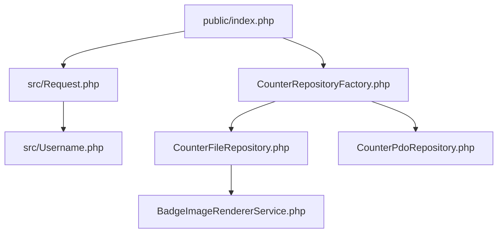

# antonkomarev/github-profile-views-counter

> Badge compteur de visites de profil GitHub, hébergé gratuitement, pour personnaliser un README de profil.

## Le problème
GitHub n'affiche pas combien de fois ton profil est consulté.

## Ce que ça fait vraiment
Une image dynamique du service komarev.com compte les requêtes reçues du proxy d'images de GitHub (Camo) et affiche le total. Options : couleur, style, libellé, nombre de départ, abréviation. Le README précise que c'est une preuve de concept : il compte des chargements de page, pas des visiteurs uniques.

## Comment c'est branché


## Essayer
```bash
# Aucune commande : ajouter dans le README du profil
# 
```

## Coût et pièges
Gratuit, mais le compteur dépend du serveur de l'auteur, financé par dons ; ne pas compter sur sa durée. Les chiffres sont gonflables et ne mesurent pas des visiteurs uniques.

## Ce que ce n'est pas
Pas un outil d'analyse : pas de statistiques détaillées (renvoyées vers un autre service). Pas une mesure d'audience fiable.

## Alternatives
- Ÿ HŸPE : service plus complet, avec statistiques détaillées.

## Pour toi
À ignorer : gadget cosmétique, sans valeur pour un travail data, IA ou MLOps.

