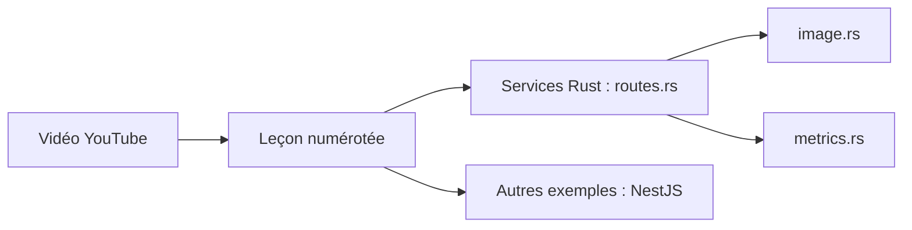

# antonputra/tutorials

> Companion code for Anton Putra's YouTube videos on AWS, Kubernetes, Terraform and benchmarks.

## The problem
Following a video tutorial without the associated code means retyping everything.

## What it actually does
Gathers numbered lessons with the examples from each video. The README is only a list of links (Terraform on AWS, EKS, Argo CD, Kubernetes, benchmarks playlists) and a consulting offer. From the sampled code, there are Rust services (images, device API) and a NestJS controller; the rest is not documented.

## How it is wired

## Trying it
No documented command. Each lesson has its own instructions, not read here.

## Cost and gotchas
Free for the code; the AWS and Kubernetes resources of the exercises are billed to you. Nearly empty README: finding the right lesson means going through the videos.

## What it is not
Not a product or a library: a repository of disparate demos. No maintenance guarantee from one lesson to the next.

## Alternatives
No alternative named in the README.

## For you
Worth watching: occasionally useful for MLOps (EKS, Terraform, Argo CD), but to be picked through video by video.
