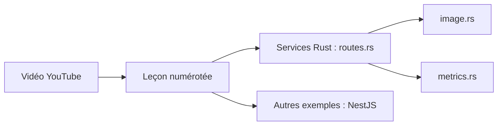

# antonputra/tutorials

> Code d'accompagnement des vidéos YouTube d'Anton Putra sur AWS, Kubernetes, Terraform et benchmarks.

## Le problème
Suivre un tutoriel vidéo sans le code associé oblige à tout retaper.

## Ce que ça fait vraiment
Rassemble des leçons numérotées avec les exemples de chaque vidéo. Le README n'est qu'une liste de liens (playlists Terraform sur AWS, EKS, Argo CD, Kubernetes, benchmarks) et une offre de conseil. D'après le code échantillonné, on trouve des services Rust (images, API d'appareils) et un contrôleur NestJS ; le reste n'est pas documenté.

## Comment c'est branché

## Essayer
Aucune commande documentée. Chaque leçon a ses propres instructions, non lues ici.

## Coût et pièges
Gratuit pour le code ; les ressources AWS et Kubernetes des exercices sont facturées à ta charge. README quasi vide : repérer la bonne leçon demande de passer par les vidéos.

## Ce que ce n'est pas
Pas un produit ni une bibliothèque : un dépôt de démos disparates. Aucune garantie de maintenance d'une leçon à l'autre.

## Alternatives
Aucune alternative nommée dans le README.

## Pour toi
À surveiller : utile ponctuellement pour le MLOps (EKS, Terraform, Argo CD), mais à piocher vidéo par vidéo.

