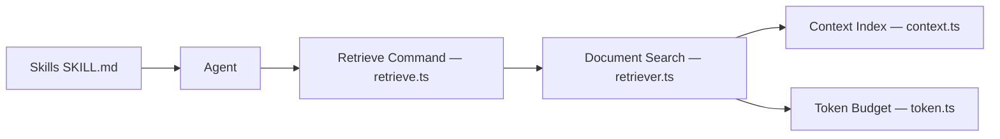

# antvis/chart-visualization-skills

> Agent skills for generating AntV charts (G2, G6, X6), with a documentation search service.

## The problem
LLMs often generate outdated G2 or G6 code (API v4 instead of v5) and hallucinate options.

## What it actually does
The repository provides skills (G2 v5, G6 v5, X6 v3, GPT-Vis, infographics, T8 narratives, icon search) installable as a Claude Code plugin or via `npx skills`. It also exposes a context search (hybrid FTS + vectors) over the G2/G6/X6 docs, through a hosted HTTP API, the `antv` CLI and a JS API. The README cites an evaluation on 174 cases, with gains over Context7 (not verified here).

## How it is wired


## Trying it
```bash
/plugin marketplace add antvis/chart-visualization-skills
npx skills add antvis/chart-visualization-skills
npm install -g @antv/chart-visualization-skills
antv retrieve "bar chart" --library g2 --topk 10
```

## Cost and gotchas
Free. The public HTTP service (`sive.antv.antgroup.com`) is a third party; the CLI allows local retrieval. The project only merges AI-generated code.

## What it is not
Not a charting library: it relies on AntV. It is not Python/matplotlib.

## Alternatives
Context7: the README's comparison baseline, less precise according to their measurements.

## For you
Worth watching: useful if you generate web charts with an agent, less so if your workflow is in Python.
