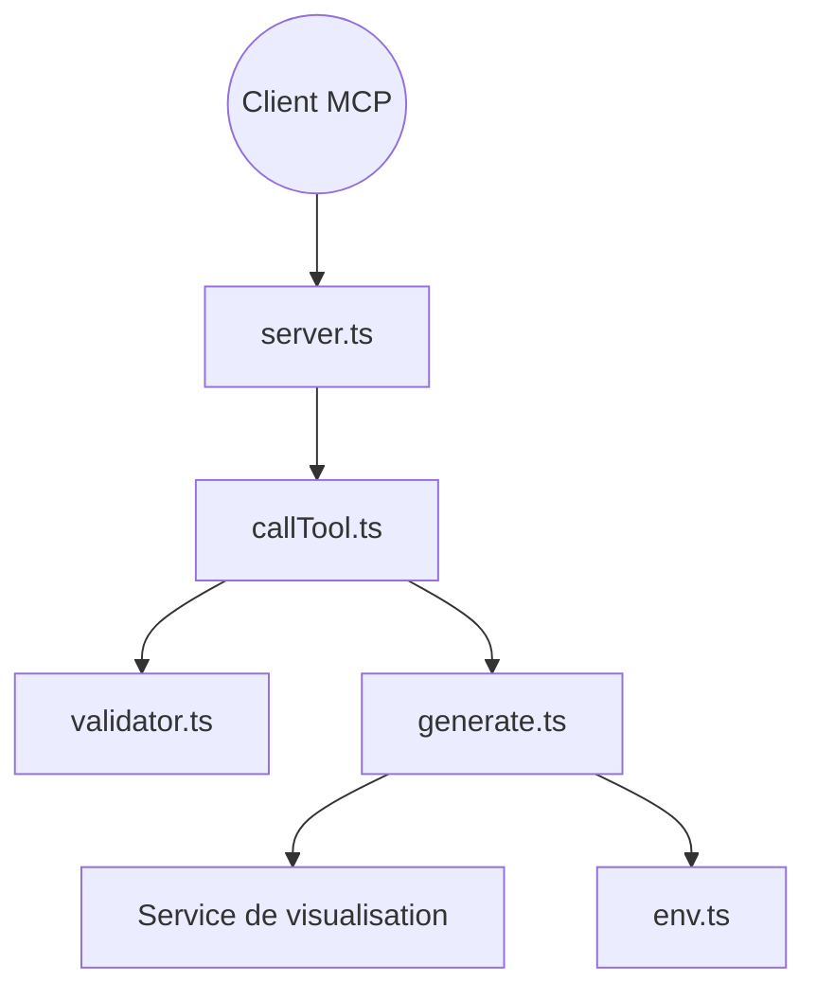

# antvis/mcp-server-chart

> TypeScript MCP server that generates more than twenty-five chart types at the request of an AI assistant.

## The problem
An AI assistant produces data but not readable charts, with no bridge to a rendering engine.

## What it actually does
Exposes MCP tools (line, bar, box plots, sankey, mind map, fishbone diagram, pivot tables, maps). It validates the input, calls a remote generation service and returns the image URL. Transports: stdio, SSE or streamable HTTP.

## How it is wired


## Trying it
```bash
npx -y @antv/mcp-server-chart
npm install -g @antv/mcp-server-chart
mcp-server-chart --transport streamable
cd docker
docker compose up -d
```

## Cost and gotchas
Free, but by default rendering goes through the `antv-studio.alipay.com` service: the chart data leaves your machine. `VIS_REQUEST_SERVER` allows a private deployment with GPT-Vis-SSR. Maps only cover China (AMap service).

## What it is not
Not a local rendering engine: the image comes from a remote service. Nor is it a charting library.

## Alternatives
No alternative named in the README, apart from the same project's `chart-visualization` skill for choosing the chart type.

## For you
Adopt to give an agent charts in a few minutes, provided you accept sending the data to the remote service or deploy your own.
