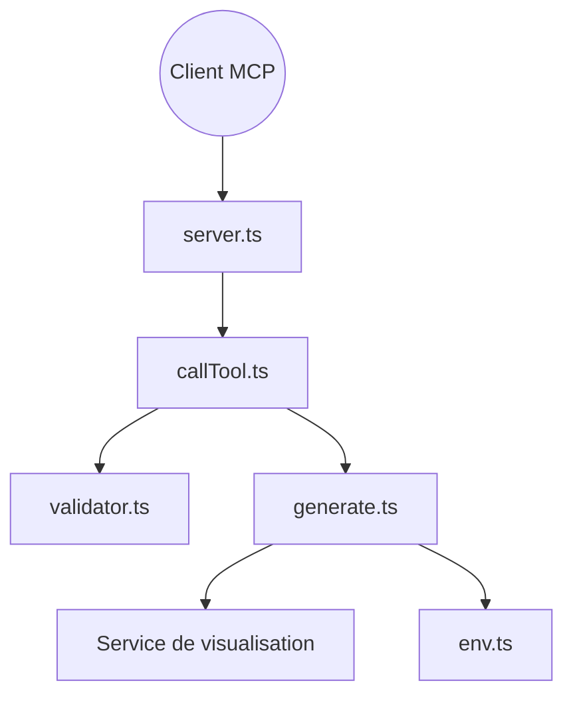

# antvis/mcp-server-chart

> Serveur MCP en TypeScript qui génère plus de vingt-cinq types de graphiques à la demande d'un assistant IA.

## Le problème
Un assistant IA produit des données mais pas de graphiques lisibles, sans pont vers un moteur de rendu.

## Ce que ça fait vraiment
Expose des outils MCP (courbes, barres, boîtes à moustaches, sankey, carte mentale, diagramme en arêtes de poisson, tableaux croisés, cartes). Il valide l'entrée, appelle un service de génération distant et renvoie l'URL de l'image. Transports stdio, SSE ou HTTP streamable.

## Comment c'est branché


## Essayer
```bash
npx -y @antv/mcp-server-chart
npm install -g @antv/mcp-server-chart
mcp-server-chart --transport streamable
cd docker
docker compose up -d
```

## Coût et pièges
Gratuit, mais par défaut le rendu passe par le service `antv-studio.alipay.com` : les données du graphique quittent ta machine. `VIS_REQUEST_SERVER` permet un déploiement privé avec GPT-Vis-SSR. Les cartes ne couvrent que la Chine (service AMap).

## Ce que ce n'est pas
Ce n'est pas un moteur de rendu local : l'image vient d'un service distant. Ce n'est pas non plus une bibliothèque de graphiques.

## Alternatives
Aucune alternative nommée dans le README, sinon le skill `chart-visualization` du même projet pour le choix du type de graphique.

## Pour toi
Adopter pour donner des graphiques à un agent en quelques minutes, à condition d'accepter l'envoi des données au service distant ou de déployer le tien.

