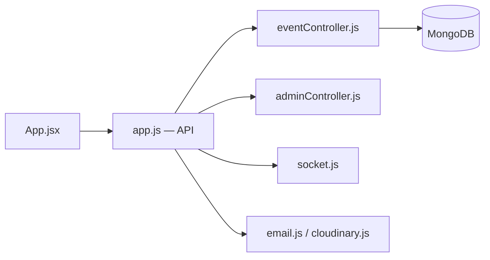

# anubhavxdev/Event-management-system-main

> Full-stack web application for event management with QR-code PDF tickets and real-time check-in.

## The problem
Organizers and attendees need a tool to publish, register for, check in to and rate events.

## What it actually does
An Express/MongoDB API with JWT and Socket.IO, and a React/Vite/Tailwind front end, with three roles: customer (registration, PDF ticket with QR, reviews), organizer (attendees, CSV export, real-time check-in) and administrator (moderation, statistics). The code sends emails and stores posters on Cloudinary.

## How it is wired


## Trying it
```bash
cd backend && npm install
cd ../frontend && npm install
cd ../backend
npm run dev
node src/seed.js
```
(Create a `backend/.env` file with `PORT`, `MONGODB_URI`, `JWT_SECRET`, `CLIENT_ORIGIN`.)

## Cost and gotchas
MongoDB required. Demo accounts with trivial passwords (`password`) and a sample JWT secret: change them before any deployment. 153 open issues for 69 stars.

## What it is not
Not "production-ready" despite the README's claim: a study project. Unrelated to data or AI.

## Alternatives
No alternative named in the README.

## For you
Ignore: generic web application outside your domain, with no data or AI component, and the demo passwords show example-level security.
