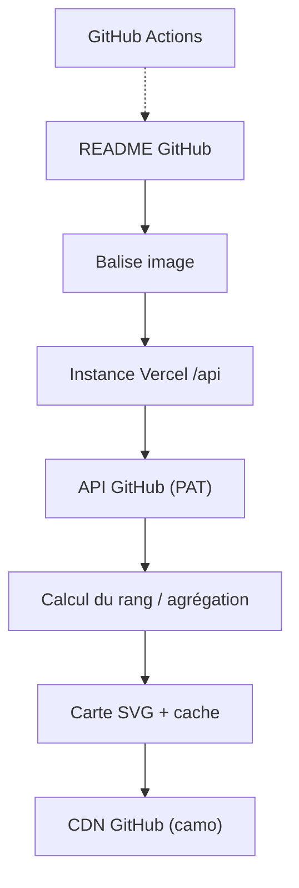

# anuraghazra/github-readme-stats

> A service that generates SVG charts of GitHub statistics to be pasted into a README file.

## The problem
A GitHub profile does not display a numerical summary, nor does it allow for more than six pinned repositories.
Creating and maintaining these visuals manually is impossible.

## What it actually does
An API URL returns an SVG map: overall statistics, most used languages, pinned repository, gist, WakaTime.
Configurable via query string: theme, colors, metric masking, width, radius, locale, cache duration.
The ranking (S to C) is calculated as a weighted sum of percentiles, implemented in `src/calculateRank.js`.
Five layouts for the language map: normal, compact, donut, vertical donut, camembert.

## How it is wired


## Trying it
```md
[](https://github.com/anuraghazra/github-readme-stats)
```

## Cost and gotchas
Free. The public instance is "best-effort" and is subject to bandwidth limitations – self-hosting is recommended.
Private statistics require you to host your own instance with a personal GitHub token.

## What it is not
**The repository is no longer maintained:** the README redirects to GitHub Stats Extended, an active fork.
This is not a measure of skill: the language map measures the number of code bytes in your un-forked repositories.
It is limited to the first 100 repositories, and does not take into account your contributions in other repositories.

## Alternatives
- GitHub Stats Extended: The fork is maintained and designated as the successor by the README.
- GitHub Readme Stats Action: Generate statistics for your own profile repository.

## For you
Archived, and of no technical interest for a data/AI profile. Please disregard.
