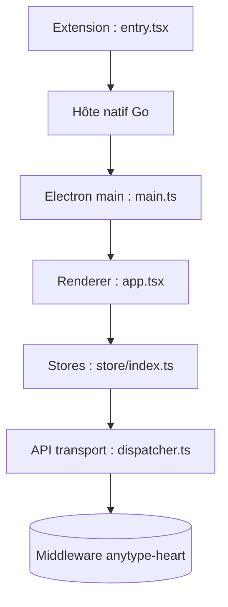

# anyproto/anytype-ts

> Desktop client for a personal knowledge base, local-first, end-to-end encrypted.

## The problem
Note-taking and wiki tools often store your data with a third party. Anytype keeps everything local and encrypted, with optional synchronization between devices.

## What it actually does
Electron application with a React/TypeScript interface engine. The data engine is not in this repo: it is the external middleware `anytype-heart`, called over gRPC with generated protobuf bindings. The interface offers block-based pages, databases (table, kanban, calendar, graph), chat and import from Notion or Obsidian. A browser extension talks to the application through a native Go host.

## How it is wired


## Trying it
```bash
git clone https://github.com/anyproto/anytype-ts.git && cd anytype-ts
bun install
./update.sh <macos-latest|ubuntu-latest|windows-latest> <arm|amd>
bun run generate:protos
bun run update:locale
bun run dist:<linux|win|mac>
```
Simpler: download the installer from download.anytype.io.

## Cost and gotchas
The application is free to download; a "membership" section exists in the interface, with no pricing detail in the README. Building from source requires bun, protoc, a C++ compiler on ARM, and the `anytype-heart` engine. License "Any Source Available License 1.0", not recognized by GitHub.

## What it is not
It is not free software in the strict sense: the code is available under a custom license. This repo is only the client: without the middleware, nothing runs.

## Alternatives
No alternative named in the README (import from Notion and Obsidian mentioned).

## For you
Worth watching: a local, encrypted note-taking tool is useful for a data profile keeping sensitive notes, but the custom license should be read before any use in a company.
