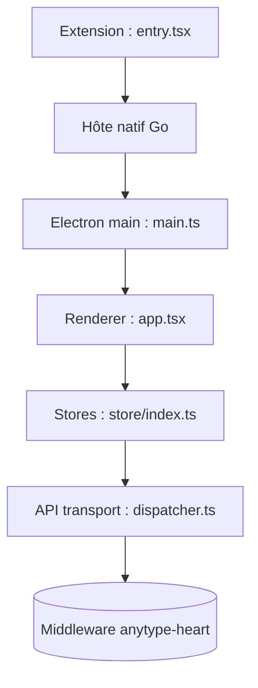

# anyproto/anytype-ts

> Client de bureau d'une base de connaissances personnelle, locale d'abord, chiffrée de bout en bout.

## Le problème
Les outils de notes et de wikis stockent souvent tes données chez un tiers. Anytype garde tout en local, chiffré, avec synchronisation optionnelle entre appareils.

## Ce que ça fait vraiment
Application Electron avec un moteur d'interface React/TypeScript. Le moteur de données n'est pas dans ce dépôt : c'est le middleware externe `anytype-heart`, appelé en gRPC avec des liaisons protobuf générées. L'interface propose pages à blocs, bases de données (tableau, kanban, calendrier, graphe), chat et import depuis Notion ou Obsidian. Une extension de navigateur parle à l'application via un hôte natif Go.

## Comment c'est branché


## Essayer
```bash
git clone https://github.com/anyproto/anytype-ts.git && cd anytype-ts
bun install
./update.sh <macos-latest|ubuntu-latest|windows-latest> <arm|amd>
bun run generate:protos
bun run update:locale
bun run dist:<linux|win|mac>
```
Plus simple : télécharger l'installateur depuis download.anytype.io.

## Coût et pièges
L'application est gratuite à télécharger ; une section « membership » existe dans l'interface, sans détail de prix dans le README. Compiler depuis les sources demande bun, protoc, un compilateur C++ sur ARM, et le moteur `anytype-heart`. Licence « Any Source Available License 1.0 », non reconnue par GitHub.

## Ce que ce n'est pas
Ce n'est pas du logiciel libre au sens strict : le code est disponible sous licence propre. Ce dépôt n'est que le client : sans le middleware, rien ne tourne.

## Alternatives
Aucune alternative nommée dans le README (import depuis Notion et Obsidian mentionné).

## Pour toi
À surveiller : un outil de notes local et chiffré est utile pour un profil data qui garde des notes sensibles, mais la licence propre est à lire avant tout usage en entreprise.

