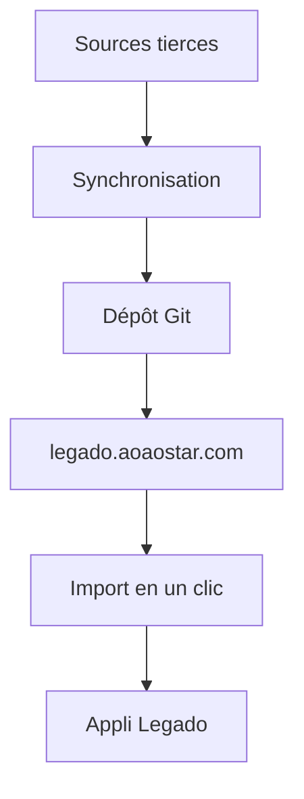

# aoaostar/legado

> Collection of book sources, feeds, themes and rules for the Chinese reading app "阅读" (Legado).

## The problem
The Legado reading app needs novel sources and settings to import; finding them and keeping them up to date is tedious.

## What it actually does
The README lists categories (book sources, feeds, cleanup rules, layout, themes, TTS reading engines) with direct links, one-click import and a sync status (number of entries, date). The repository does not allow one-click import from Git: it points to the site legado.aoaostar.com. One source (shidahuilang) is marked as having failed to sync.

## How it is wired
Simplified diagram based on the sheet, no diagram provided.

## Trying it
No documented command: you import the sources from the site legado.aoaostar.com into the Legado app.

## Cost and gotchas
Free. No license: reuse rights unknown. The sources come from third parties and potentially target protected content; check before use.

## What it is not
Not the Legado app itself, nor a data tool. The README is in Chinese, with no technical documentation.

## Alternatives
No alternative named in the README.

## For you
Ignore: a resource list for a Chinese novel reading app, unrelated to data, AI or MLOps, and with no license.
