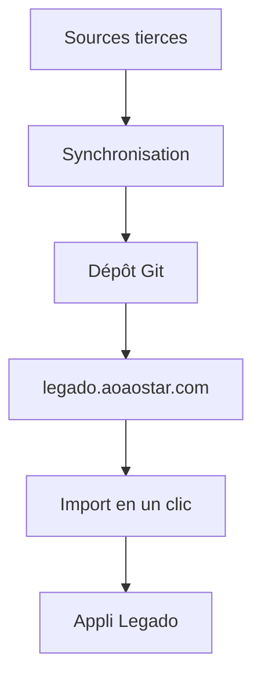

# aoaostar/legado

> Collection de sources de livres, flux, thèmes et règles pour l'appli de lecture chinoise « 阅读 » (Legado).

## Le problème
L'appli de lecture Legado a besoin de sources de romans et de réglages à importer ; les trouver et les tenir à jour est fastidieux.

## Ce que ça fait vraiment
Le README liste des catégories (sources de livres, flux, règles de nettoyage, mise en page, thèmes, moteurs de lecture TTS) avec liens directs, import en un clic et un état de synchronisation (nombre d'entrées, date). Le dépôt ne permet pas l'import en un clic depuis Git : il renvoie au site legado.aoaostar.com. Une source (shidahuilang) est marquée en échec de synchronisation.

## Comment c'est branché
Schéma simplifié d'après la fiche, sans diagramme fourni.

## Essayer
Aucune commande documentée : on importe les sources depuis le site legado.aoaostar.com dans l'appli Legado.

## Coût et pièges
Gratuit. Pas de licence : droit de réutilisation inconnu. Les sources viennent de tiers et visent du contenu protégé potentiellement ; à vérifier avant usage.

## Ce que ce n'est pas
Pas l'appli Legado elle-même ni un outil de data. Le README est en chinois, sans documentation technique.

## Alternatives
Aucune alternative nommée dans le README.

## Pour toi
À ignorer : liste de ressources pour une appli de lecture de romans chinois, sans lien avec data, IA ou MLOps, et sans licence.

