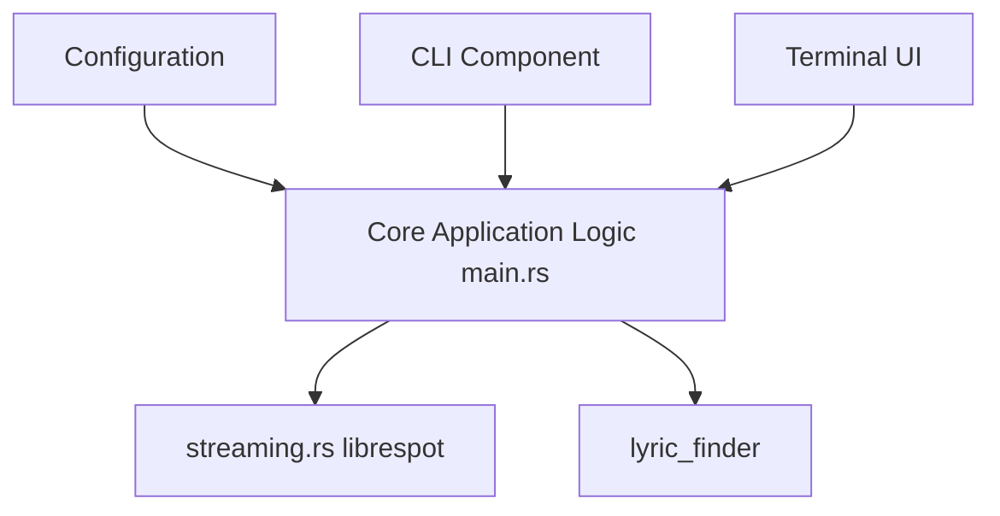

# aome510/spotify-player

> Configurable Spotify music player in the terminal, with streaming, Connect, lyrics and CLI.

## The problem
The official Spotify client is heavy and poorly suited to the terminal or to scripts.

## What it actually does
Terminal interface (ratatui) with pages and popups, direct streaming via librespot, Spotify Connect remote control, audio visualization, synchronized lyrics, notifications, daemon mode. CLI commands (`get`, `playback`, `search`, `connect`, `like`, `authenticate`, `playlist`) go through a local socket.

## How it is wired


## Trying it
```bash
cargo install spotify_player --locked
spotify_player authenticate
docker pull aome510/spotify_player:latest
```

## Cost and gotchas
Spotify Premium required. Shared ncspot client ID by default: risk of quota limits, hence the advice to register your own. Streaming is disabled in the Docker image.

## What it is not
Not a client independent of Spotify. The source README is truncated after the commands table.

## Alternatives
No alternative named in the README.

## For you
Ignore: a music player unrelated to data or MLOps, and dependent on a paid account.
