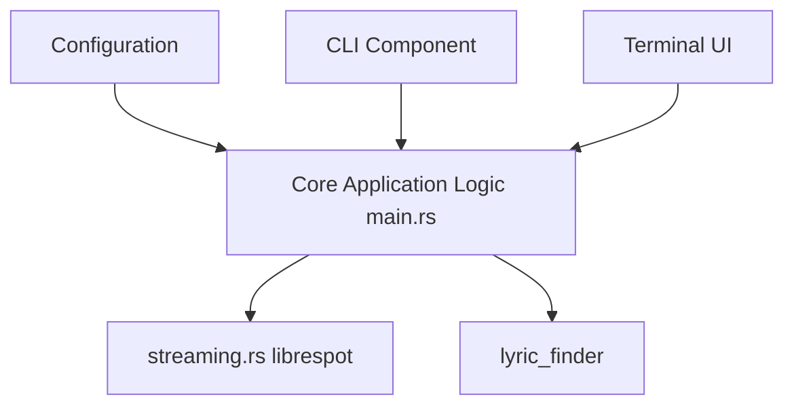

# aome510/spotify-player

> Lecteur de musique Spotify en terminal, configurable, avec streaming, Connect, paroles et CLI.

## Le problème
Le client Spotify officiel est lourd et peu adapté au terminal ou aux scripts.

## Ce que ça fait vraiment
Interface terminal (ratatui) avec pages et popups, streaming direct via librespot, télécommande Spotify Connect, visualisation audio, paroles synchronisées, notifications, mode démon. Des commandes CLI (`get`, `playback`, `search`, `connect`, `like`, `authenticate`, `playlist`) passent par un socket local.

## Comment c'est branché


## Essayer
```bash
cargo install spotify_player --locked
spotify_player authenticate
docker pull aome510/spotify_player:latest
```

## Coût et pièges
Spotify Premium obligatoire. Identifiant partagé ncspot par défaut : risque de limite de quota, d'où l'avis d'enregistrer le sien. Le streaming est désactivé dans l'image Docker.

## Ce que ce n'est pas
Pas un client indépendant de Spotify. Le README source est tronqué après le tableau des commandes.

## Alternatives
Aucune alternative nommée dans le README.

## Pour toi
À ignorer : lecteur musical sans rapport avec data ou MLOps, et dépendant d'un compte payant.

