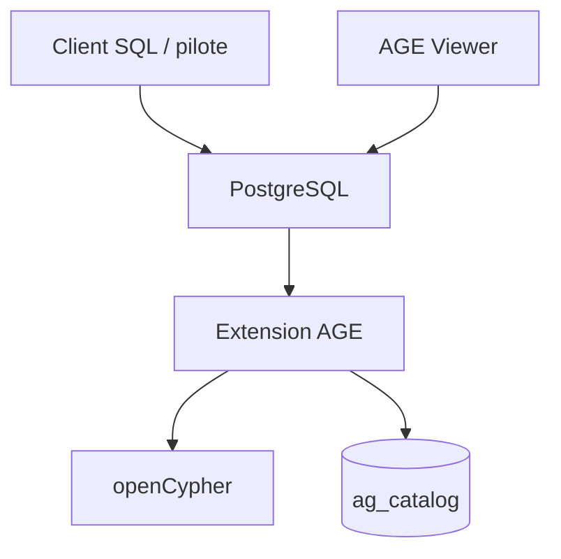

# apache/age

> PostgreSQL extension that adds a graph database queryable in openCypher, for those who want SQL and graph together.

## The problem
Storing relationships as a graph forces you to add a second database alongside PostgreSQL.

## What it actually does
AGE installs into PostgreSQL (11 to 18) and lets you mix SQL and openCypher queries in a single storage, with multiple graphs and property indexes. Each connection must load the extension and set the `search_path`. Go, Java, Node.js and Python drivers, and a web viewer.

## How it is wired
Simplified diagram based on the sheet, no diagram provided.


## Trying it
```bash
docker pull apache/age
make install
```
```sql
CREATE EXTENSION age;
LOAD 'age';
SET search_path = ag_catalog, "$user", public;
SELECT create_graph('graph_name');
```

## Cost and gotchas
Free. Clients without autocommit (psycopg 3, JDBC): graph creations stay invisible without `commit()`. Install the extension before granting CREATE to other roles.

## What it is not
Not a standalone graph database: PostgreSQL is required. Nor is it a version of PostgreSQL.

## Alternatives
No alternative named in the README (AgensGraph cited as a source of inspiration).

## For you
Worth watching: relevant for knowledge graphs on existing PostgreSQL, with no new database to operate.
