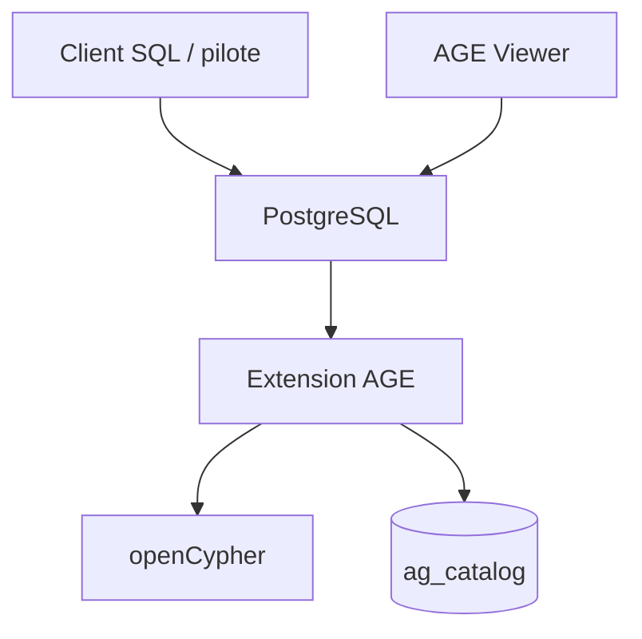

# apache/age

> Extension PostgreSQL qui ajoute une base de graphes interrogeable en openCypher, pour qui veut SQL et graphe ensemble.

## Le problème
Stocker des relations en graphe oblige à ajouter une seconde base à côté de PostgreSQL.

## Ce que ça fait vraiment
AGE s'installe dans PostgreSQL (11 à 18) et permet de mêler SQL et requêtes openCypher dans un même stockage, avec plusieurs graphes et des index de propriétés. Chaque connexion doit charger l'extension et régler le `search_path`. Pilotes Go, Java, Node.js et Python, et un visualiseur web.

## Comment c'est branché
Schéma simplifié d'après la fiche, sans diagramme fourni.


## Essayer
```bash
docker pull apache/age
make install
```
```sql
CREATE EXTENSION age;
LOAD 'age';
SET search_path = ag_catalog, "$user", public;
SELECT create_graph('graph_name');
```

## Coût et pièges
Gratuit. Client sans autocommit (psycopg 3, JDBC) : les créations de graphe restent invisibles sans `commit()`. Installer l'extension avant d'accorder CREATE à d'autres rôles.

## Ce que ce n'est pas
Pas une base de graphes autonome : il faut PostgreSQL. Ce n'est pas une version de PostgreSQL non plus.

## Alternatives
Aucune alternative nommée dans le README (AgensGraph cité comme source d'inspiration).

## Pour toi
À surveiller : pertinent pour des graphes de connaissances sur du PostgreSQL existant, sans nouvelle base à exploiter.

