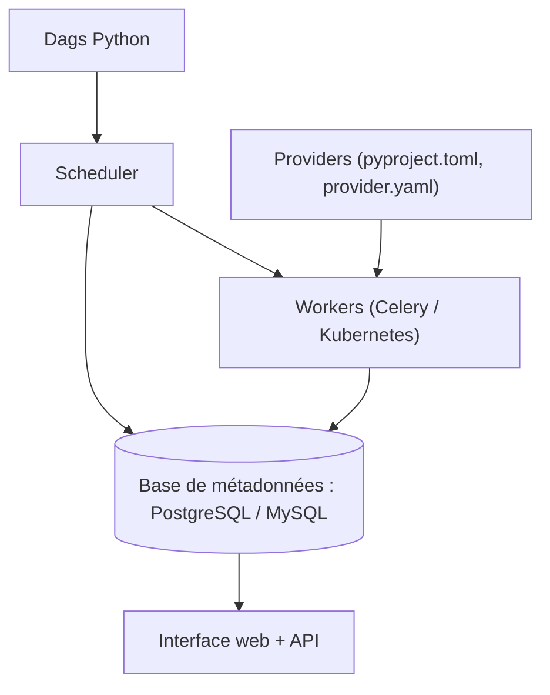

# apache/airflow

> Scheduler for workflows defined in Python, for data and ML teams in production.

## The problem
Without it, processing chains live in crontabs and scripts: implicit dependencies,
manual recovery after failure, no visibility into what is running.

## What it actually does
Has you write Dags in Python; a scheduler runs the tasks on a fleet of workers while
respecting the declared dependencies. The UI shows Dags, Assets, Grid view, Graph view,
backfill over a date range and a Dag's source code.
The README states its opinion: idempotent tasks, no large volumes passed from task to task
(XCom is only for metadata), and delegation of heavy compute to specialized services.

## How it is wired


## Trying it
```bash
pip install 'apache-airflow==3.3.0' \
 --constraint "https://raw.githubusercontent.com/apache/airflow/constraints-3.3.0/constraints-3.10.txt"
pip install 'apache-airflow[postgres,google]==3.3.0' \
 --constraint "https://raw.githubusercontent.com/apache/airflow/constraints-3.3.0/constraints-3.10.txt"
```

## Cost and gotchas
Free (Apache 2.0). The constraints file is not optional: `pip install apache-airflow`
alone "will occasionally not work". Only pip and uv are supported, not Poetry or pip-tools.
SQLite is forbidden in production; Windows is not supported, only WSL2 or containers.

## What it is not
It is not a streaming solution: it handles real time through batches drawn from streams.
It is not made for Dags whose structure changes at every run. It is not an agent:
on LLM workloads it orchestrates the steps, it does not reason.

## Alternatives
- **Luigi**: similar project cited by the README, lighter.
- **Oozie**: scheduler from the Hadoop ecosystem.
- **Azkaban**: another batch scheduler cited as comparable.

## For you
The default foundation if you need to retrain, evaluate and deploy models on a schedule.
