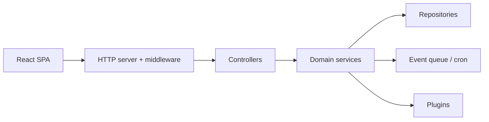

# apache/answer

> Self-hosted question-and-answer platform, for community forums, help centers and knowledge bases.

## The problem
A forum or an internal knowledge base requires assembling questions, answers, votes, moderation and notifications.

## What it actually does
A Go server with a React interface: questions, answers, comments, tags, revisions, reviews, votes, badges, notifications. A plugin system covers authentication, CAPTCHA, storage, search (including vector search), notifications. According to the code: AI conversations, embeddings and MCP routes, an internal event queue and cron jobs.

## How it is wired


## Trying it
```bash
docker run -d -p 9080:80 -v answer-data:/data --name answer apache/answer:2.0.2
make generate
make ui
make build
```

## Cost and gotchas
Building: Go 1.23+, Node 20+, pnpm 9+, mockgen and wire. The `/data` volume must persist. 137 open issues.

## What it is not
It is not a document search tool: it is a Q&A-style forum. The AI and MCP parts are described by the code, not by the README.

## Alternatives
No alternative named in the README.

## For you
Worth watching: an internal Q&A base for a data team, under Apache governance, with an interesting MCP entry point to test.
