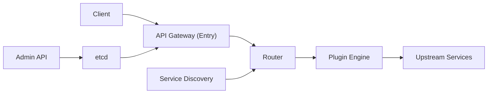

# apache/apisix

> API gateway on NGINX and etcd, with hot-reloadable plugins and possible use as an LLM gateway, for platform teams.

## The problem
Exposing several services (and LLMs) behind a single entry point requires routing, authentication, quotas and observability. Without a gateway, each service reimplements them.

## What it actually does
The data plane (OpenResty/NGINX) routes requests and applies chained plugins (auth, rate limiting, rewriting, logs). Configuration comes from etcd through the Admin API, without restart. "AI" plugins proxy several LLM providers with fallback and token-based rate limiting. Plugins in Lua, or Java/Go/Python/Node via RPC, Wasm experimental.

## How it is wired


## Trying it
```bash
curl -sL https://run.api7.ai/apisix/quickstart | sh
curl "http://127.0.0.1:9080" --head | grep Server
curl -i "http://127.0.0.1:9180/apisix/admin/routes/1" -X PUT -d '{"uri":"/get","upstream":{"type":"roundrobin","nodes":{"httpbin.org:80":1}}}'
curl "http://127.0.0.1:9080/get"
```

## Cost and gotchas
Free; Docker required for the quickstart, etcd to operate in production. The install script is run via curl | sh.

## What it is not
Not a turnkey LLM proxy: the AI features are plugins to assemble. Not a managed service. Operating etcd and NGINX remains your responsibility.

## Alternatives
The README cites Kong and Orange as inspirations.

## For you
Worth watching: only useful if you must manage a fleet of APIs or LLMs with per-token quotas; for a single model, it is too heavy.
