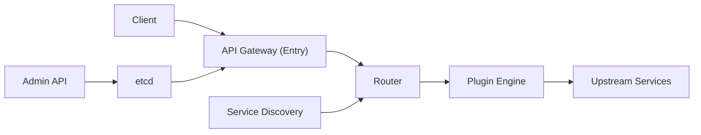

# apache/apisix

> Passerelle d'API sur NGINX et etcd, avec plugins à chaud et usage possible comme passerelle LLM, pour équipes plateforme.

## Le problème
Exposer plusieurs services (et des LLM) derrière un point d'entrée unique demande routage, authentification, quotas et observabilité. Sans passerelle, chaque service les réimplémente.

## Ce que ça fait vraiment
Le plan de données (OpenResty/NGINX) route les requêtes et applique des plugins en chaîne (auth, limitation, réécriture, logs). La configuration vient d'etcd via l'Admin API, sans redémarrage. Des plugins « AI » proxifient plusieurs fournisseurs de LLM avec repli et limitation par tokens. Plugins en Lua, ou Java/Go/Python/Node via RPC, Wasm expérimental.

## Comment c'est branché


## Essayer
```bash
curl -sL https://run.api7.ai/apisix/quickstart | sh
curl "http://127.0.0.1:9080" --head | grep Server
curl -i "http://127.0.0.1:9180/apisix/admin/routes/1" -X PUT -d '{"uri":"/get","upstream":{"type":"roundrobin","nodes":{"httpbin.org:80":1}}}'
curl "http://127.0.0.1:9080/get"
```

## Coût et pièges
Gratuit ; Docker requis pour le quickstart, etcd à exploiter en production. Le script d'installation est exécuté via curl | sh.

## Ce que ce n'est pas
Pas un proxy LLM clé en main : les fonctions IA sont des plugins à assembler. Pas un service géré. Opérer etcd et NGINX reste à ta charge.

## Alternatives
Le README cite Kong et Orange comme inspirations.

## Pour toi
À surveiller : utile seulement si tu dois piloter un parc d'API ou de LLM avec quotas par tokens ; pour un seul modèle, c'est trop lourd.

