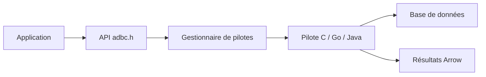

# apache/arrow-adbc

> Arrow-based database access API standard, with C, Go and Java drivers.

## The problem
Converting each database's results to Arrow requires driver-specific code.

## What it actually does
Defines an API (version 1.0.0, `adbc.h`) for reading and writing columnar data through Arrow. Drivers implement it, and a driver manager loads them dynamically, like JDBC or ODBC. Complementary to Arrow Flight SQL, which is a protocol.

## How it is wired
Simplified diagram based on the fiche, no diagram provided.

## Trying it
No command in the README: installation is detailed at https://arrow.apache.org/adbc.

## Cost and gotchas
Free. The standard is stable but the libraries are still in development, with 358 open issues. Installation varies by language.

## What it is not
Not a replacement for JDBC or ODBC: it targets bulk columnar transfer. Not a network protocol like Flight SQL.

## Alternatives
- Arrow Flight SQL: network protocol that requires support on the database side.

## For you
Adopt: for loading large volumes of data from databases directly into Arrow, without costly conversions, with the backing of the Apache foundation.
