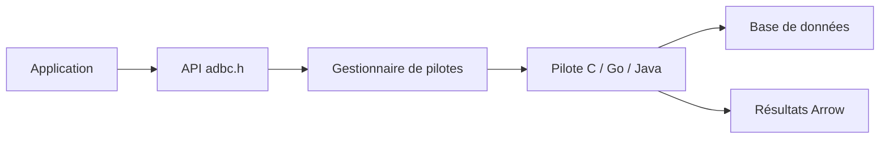

# apache/arrow-adbc

> Standard d'API d'accès aux bases de données basé sur Arrow, avec pilotes C, Go et Java.

## Le problème
Convertir les résultats de chaque base vers Arrow demande du code propre à chaque pilote.

## Ce que ça fait vraiment
Définit une API (version 1.0.0, `adbc.h`) pour lire et écrire des données en colonnes via Arrow. Des pilotes l'implémentent, et un gestionnaire de pilotes les charge dynamiquement, comme JDBC ou ODBC. Complémentaire d'Arrow Flight SQL, qui est un protocole.

## Comment c'est branché
Schéma simplifié d'après la fiche, sans diagramme fourni.

## Essayer
Aucune commande dans le README : l'installation est détaillée sur https://arrow.apache.org/adbc.

## Coût et pièges
Gratuit. Le standard est stable mais les bibliothèques sont encore en développement, avec 358 issues ouvertes. L'installation varie selon le langage.

## Ce que ce n'est pas
Ce n'est pas un remplaçant de JDBC ou d'ODBC : il vise le transfert en masse en colonnes. Ce n'est pas un protocole réseau comme Flight SQL.

## Alternatives
- Arrow Flight SQL : protocole réseau qui exige un support côté base.

## Pour toi
À adopter : pour charger de gros volumes de données depuis des bases directement en Arrow, sans conversions coûteuses, avec le soutien de la fondation Apache.

