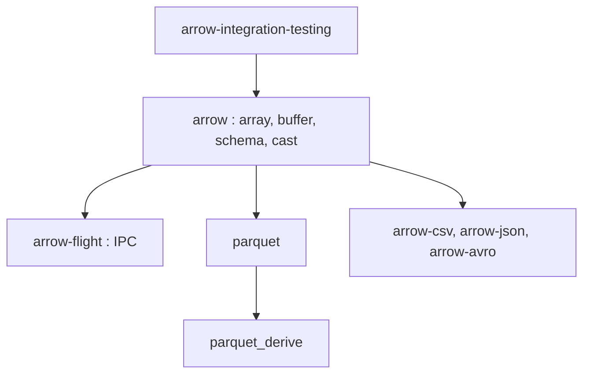

# apache/arrow-rs

> Native Rust implementation of Apache Arrow and Parquet, for data engines and analytics tools.

## The problem
Analytical workloads in Rust need an in-memory columnar format and a Parquet reader without going through C++.

## What it actually does
Provides the crates `arrow` (arrays, memory, low-level compute), `arrow-flight` (Flight IPC), `parquet` and `parquet_derive`. The code is organized into sub-crates (array, buffer, schema, cast, csv, json, avro). Monthly releases, major versions at most once per quarter, following semver.

## How it is wired

## Trying it
No command is documented in the README: installation goes through Cargo (crates.io) and each crate's documentation.

## Cost and gotchas
Free. Stable Rust required, with a minimum version (MSRV) updated in major releases. Breaking major versions are planned (61.0.0 in December 2026).

## What it is not
Not a SQL engine: for that, you need DataFusion. The `object_store` crate has left this repository for arrow-rs-object-store.

## Alternatives
- datafusion: in-memory SQL query engine on top of Arrow.
- ballista: distributed query execution.
- arrow-rs-object-store: object storage access, now in a separate repository.

## For you
Adopt if you do data work in Rust or if your tools (Polars, DataFusion) build on it: an Arrow and Parquet foundation backed by the Apache foundation, actively maintained.
