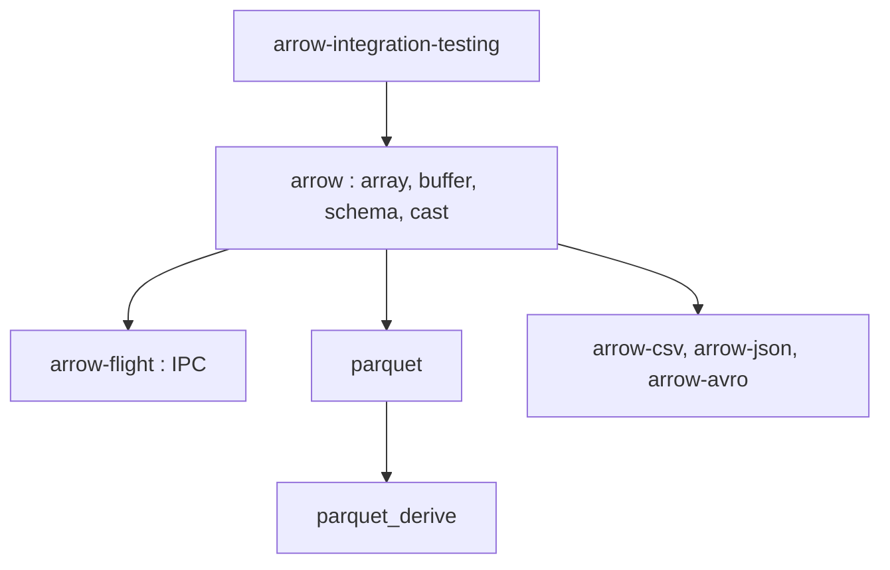

# apache/arrow-rs

> Implémentation Rust native d'Apache Arrow et de Parquet, pour moteurs de données et outils analytiques.

## Le problème
Les traitements analytiques en Rust ont besoin d'un format colonnaire en mémoire et d'un lecteur Parquet sans passer par du C++.

## Ce que ça fait vraiment
Fournit les crates `arrow` (tableaux, mémoire, calculs bas niveau), `arrow-flight` (IPC Flight), `parquet` et `parquet_derive`. Le code est organisé en sous-crates (array, buffer, schema, cast, csv, json, avro). Publication mensuelle, versions majeures au plus une fois par trimestre, en suivant semver.

## Comment c'est branché

## Essayer
Aucune commande n'est documentée dans le README : l'installation passe par Cargo (crates.io) et la documentation de chaque crate.

## Coût et pièges
Gratuit. Rust stable requis, avec une version minimale (MSRV) mise à jour dans les versions majeures. Des versions majeures cassantes sont prévues (61.0.0 en décembre 2026).

## Ce que ce n'est pas
Pas un moteur SQL : pour cela, il faut DataFusion. Le crate `object_store` a quitté ce dépôt pour arrow-rs-object-store.

## Alternatives
- datafusion : moteur de requêtes SQL en mémoire au-dessus d'Arrow.
- ballista : exécution distribuée de requêtes.
- arrow-rs-object-store : accès aux stockages objet, désormais dans un dépôt séparé.

## Pour toi
À adopter si tu fais de la donnée en Rust ou si tes outils (Polars, DataFusion) s'appuient dessus : socle Arrow et Parquet porté par la fondation Apache, maintenu activement.

