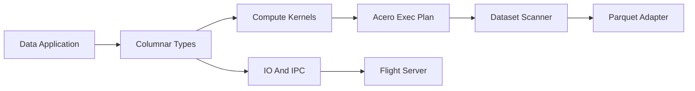

# apache/arrow

> In-memory columnar format and multi-language toolbox for exchanging and analyzing data fast.

## The problem
Every data engine has its own internal representation: exchanging a table between Python, Java or R requires costly copies and conversions.

## What it actually does
Defines a standard columnar format, an IPC format to serialize it, and Flight to exchange it over RPC. The C++ implementation provides arrays, compute kernels, Acero (query plans), Gandiva (LLVM compilation) and Parquet/ORC/CSV readers. Bindings exist for Python, R, Ruby, GLib; other languages live in separate repositories.

## How it is wired

## Trying it
No command documented in the README: it points to the website and the libraries' guides.

## Cost and gotchas
Free. The repository is a large monorepo: the .NET, Go, Java, JS, Rust, Swift, Julia and ADBC components are elsewhere. A per-language feature table is available to consult.

## What it is not
Not a database engine or a full DataFrame: it is the interoperability layer underneath them. The README does not detail installation.

## Alternatives
No alternative named in the README.

## For you
Adopt it: you already use it through pandas, Polars or Parquet; knowing it helps avoid copies between tools.
