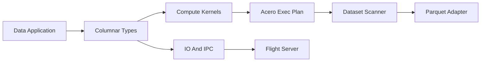

# apache/arrow

> Format colonnaire en mémoire et boîte à outils multi-langages pour échanger et analyser des données vite.

## Le problème
Chaque moteur de données a sa représentation interne : échanger un tableau entre Python, Java ou R impose des copies et conversions coûteuses.

## Ce que ça fait vraiment
Définit un format colonnaire standard, un format IPC pour le sérialiser, et Flight pour l'échanger par RPC. L'implémentation C++ fournit tableaux, compute kernels, Acero (plans de requêtes), Gandiva (compilation LLVM) et lecteurs Parquet/ORC/CSV. Des liaisons existent pour Python, R, Ruby, GLib ; d'autres langages vivent dans des dépôts séparés.

## Comment c'est branché

## Essayer
Aucune commande documentée dans le README : renvoie au site et aux guides des bibliothèques.

## Coût et pièges
Gratuit. Le dépôt est un monorepo vaste : les composants .NET, Go, Java, JS, Rust, Swift, Julia et ADBC sont ailleurs. Tableau de fonctionnalités par langage à consulter.

## Ce que ce n'est pas
Pas un moteur de base de données ni un DataFrame complet : c'est la couche d'interopérabilité sous eux. Le README ne détaille pas l'installation.

## Alternatives
Aucune alternative nommée dans le README.

## Pour toi
À adopter : tu l'utilises déjà via pandas, Polars ou Parquet ; le connaître sert à éviter les copies entre outils.

