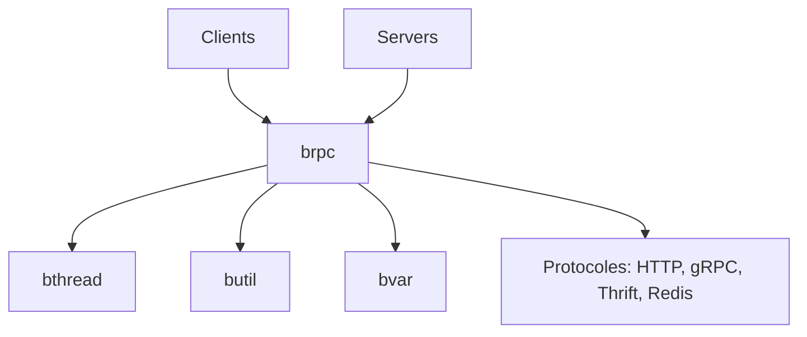

# apache/brpc

> Industrial-grade RPC framework in C++ for high-performance servers, multi-protocol on a single port.

## The problem
Building C++ services that speak HTTP, gRPC, Thrift, Redis and several in-house protocols, with built-in profiling.

## What it actually does
Sources organized into `brpc`, `bthread` (lightweight threads), `butil` (utilities) and `bvar` (metrics). Multi-protocol server on one port, synchronous, asynchronous or combined-channel clients, built-in services (status, vars, rpcz, CPU/heap/contention profilers), tools `rpc_press`, `rpc_replay`, `rpc_view`. Built with Bazel, CMake or Make.

## How it is wired


## Trying it
```bash
# Le README fourni ne contient pas de commande : il renvoie au guide « getting started »
# (étapes de compilation et exemples dans example/).
```

## Cost and gotchas
Free, Apache-2.0 license. C++ compilation is on you. The README mentions that hadoop_rpc "may be opensourced": not available.

## What it is not
Not a Python framework nor an ML tool. The README claims better performance without giving figures here.

## Alternatives
- braft: associated open source RAFT implementation, for highly available services.

## For you
Watch: useful only if you write inference or storage services in C++; otherwise outside your scope.
