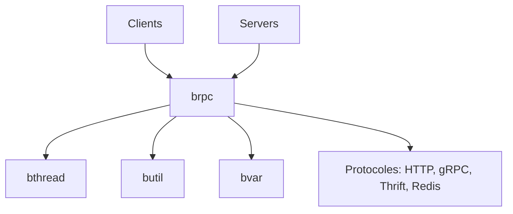

# apache/brpc

> Framework RPC industriel en C++ pour serveurs haute performance, multi-protocoles sur un même port.

## Le problème
Construire des services C++ qui parlent HTTP, gRPC, Thrift, Redis et plusieurs protocoles maison, avec profilage intégré.

## Ce que ça fait vraiment
Sources organisées en `brpc`, `bthread` (threads légers), `butil` (utilitaires) et `bvar` (métriques). Serveur multi-protocoles sur un port, clients synchrones, asynchrones ou en canaux combinés, services intégrés (status, vars, rpcz, profileurs CPU/tas/contention), outils `rpc_press`, `rpc_replay`, `rpc_view`. Build par Bazel, CMake ou Make.

## Comment c'est branché


## Essayer
```bash
# Le README fourni ne contient pas de commande : il renvoie au guide « getting started »
# (étapes de compilation et exemples dans example/).
```

## Coût et pièges
Gratuit, licence Apache-2.0. Compilation C++ à ta charge. Le README mentionne que hadoop_rpc « may be opensourced » : non disponible.

## Ce que ce n'est pas
Pas un framework Python ni un outil de ML. Le README annonce de meilleures performances sans les chiffrer ici.

## Alternatives
- braft : implémentation RAFT open source associée, pour services hautement disponibles.

## Pour toi
Surveiller : utile seulement si tu écris des services d'inférence ou de stockage en C++ ; sinon hors de ton périmètre.

