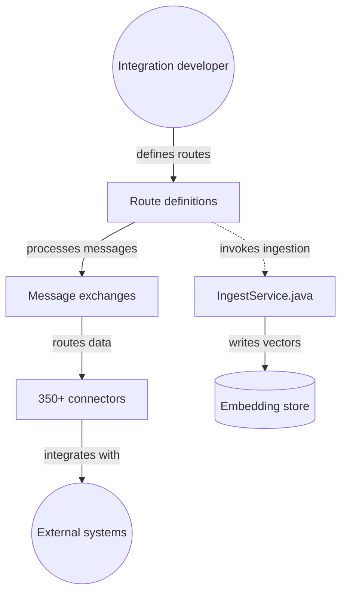

# apache/camel

> Java integration framework with more than 350 connectors, to link databases, APIs and message queues.

## The problem
Plugging heterogeneous systems together (Kafka, SQL databases, APIs, cloud) takes a lot of repetitive glue code specific to each protocol.

## What it actually does
You describe routes in Java, YAML or XML: read from an entry point, transform or apply an integration pattern, send to another endpoint. They run standalone, on Spring Boot or Quarkus, or with the Camel CLI. The README also mentions an MCP server, LangChain4j and OpenAI components, and the A2A protocol.

## How it is wired


## Trying it
```bash
camel init hello.yaml
camel run hello.yaml
```

## Cost and gotchas
Free, Apache 2.0 license. The component catalog is vast: getting started requires choosing a runtime (Spring Boot, Quarkus, CLI).

## What it is not
It is not a data science tool or an AI framework: the AI building blocks (ingestion, embeddings) remain a side part of an integration tool. Nor is it a streaming platform like Kafka, which it can only consume.

## Alternatives
Camel K (Kubernetes), Camel Quarkus and Camel Kafka Connector are the runtime variants cited in the README.

## For you
Worth watching: very mature for enterprise integration, useful if your AI pipelines must plug into existing Java and brokers.
