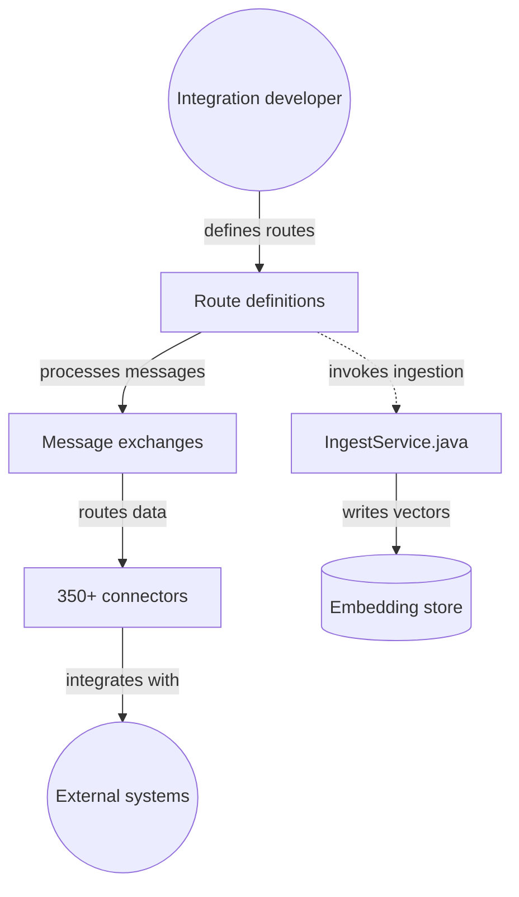

# apache/camel

> Framework d'intégration Java avec plus de 350 connecteurs, pour relier bases, API et files de messages.

## Le problème
Brancher des systèmes hétérogènes (Kafka, bases SQL, API, cloud) demande beaucoup de code de liaison répétitif et propre à chaque protocole.

## Ce que ça fait vraiment
On décrit des routes en Java, YAML ou XML : lecture sur un point d'entrée, transformation ou motif d'intégration, envoi vers un autre point. Elles tournent en autonome, sur Spring Boot ou Quarkus, ou avec la CLI Camel. Le README mentionne aussi un serveur MCP, des composants LangChain4j et OpenAI, et le protocole A2A.

## Comment c'est branché


## Essayer
```bash
camel init hello.yaml
camel run hello.yaml
```

## Coût et pièges
Gratuit, licence Apache 2.0. Le catalogue de composants est vaste : la prise en main demande de choisir un runtime (Spring Boot, Quarkus, CLI).

## Ce que ce n'est pas
Ce n'est pas un outil de data science ni un framework d'IA : les briques IA (ingestion, embeddings) restent une partie annexe d'un outil d'intégration. Ce n'est pas non plus une plateforme de streaming comme Kafka, qu'il sait seulement consommer.

## Alternatives
Camel K (Kubernetes), Camel Quarkus et Camel Kafka Connector sont les variantes d'exécution citées dans le README.

## Pour toi
À surveiller : très mûr pour l'intégration d'entreprise, utile si tes pipelines IA doivent se brancher sur du Java et des brokers existants.

