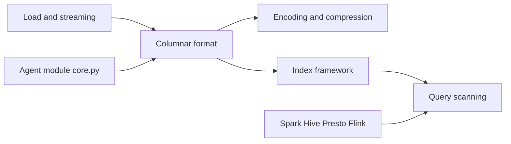

# apache/carbondata

> Indexed columnar storage format for fast analytics on Hadoop and Spark, with a recent Agent module.

## The problem
Scans of large volumes are expensive; you need a format that skips unneeded data thanks to indexes.

## What it actually does
Stores data with multi-level indexes (blocklets), queryable encodings and late materialisation. Integrations with Spark, Hive, Presto, Flink, Java and C++ SDKs, Bloom and Lucene indexes, materialised views, secondary index. The README announces an Agent module for storing agent metadata; its content is not detailed. Several features are marked experimental.

## How it is wired


## Trying it
```bash
# Le README indique seulement que le build utilise Apache Maven : aucune commande donnée.
```

## Cost and gotchas
Free. The status badge cites Spark 2.4, which raises doubts about support for recent versions.

## What it is not
Not a query engine: it depends on Spark, Hive or Presto. The link between the format and the Agent module is not established.

## Alternatives
No alternative named in the README.

## For you
Ignore: Parquet/ORC dominate the ecosystem, and the README indicates no recent Spark support.
