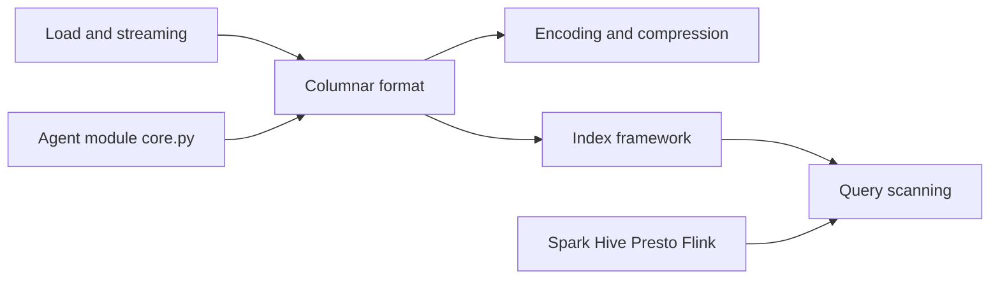

# apache/carbondata

> Format de stockage colonnaire indexé pour analyses rapides sur Hadoop et Spark, avec un module Agent récent.

## Le problème
Les scans de gros volumes sont coûteux ; il faut un format qui saute les données inutiles grâce à des index.

## Ce que ça fait vraiment
Stocke les données avec des index multi-niveaux (blocklets), des encodages interrogeables et une matérialisation tardive. Intégrations Spark, Hive, Presto, Flink, SDK Java et C++, index Bloom et Lucene, vues matérialisées, index secondaire. Le README annonce un module Agent pour stocker des métadonnées d'agents ; son contenu n'est pas détaillé. Plusieurs fonctions sont marquées expérimentales.

## Comment c'est branché


## Essayer
```bash
# Le README indique seulement que le build utilise Apache Maven : aucune commande donnée.
```

## Coût et pièges
Gratuit. Le badge de statut cite Spark 2.4, ce qui laisse douter du support des versions récentes.

## Ce que ce n'est pas
Pas un moteur de requête : il dépend de Spark, Hive ou Presto. Le lien entre le format et le module Agent n'est pas établi.

## Alternatives
Aucune alternative nommée dans le README.

## Pour toi
À ignorer : Parquet/ORC dominent l'écosystème, et le README n'indique pas de support récent de Spark.

