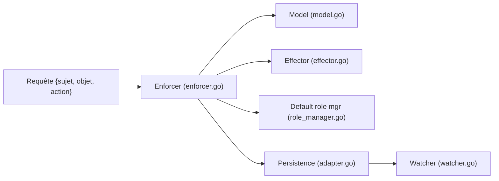

# apache/casbin

> Go access-control library, driven by a configuration model, for checking permissions inside an application.

Note: README identical to `casbin/casbin`; probably the same project under its current or previous name.

## The problem
Hard-coded access rules are hard to change; you want to change them through configuration.

## What it actually does
An `Enforcer` loads a `.conf` model (request, policy, effect, matchers) and rules, then decides allowed or denied. According to the architecture described from the code: `effector/` reduces the matching rules to a decision, `detector/` handles conflicts and priorities, `rbac/` manages roles with domains, `persist/` provides adapters, cache and watchers, `transaction*.go` handles atomic updates, `enforcer_synced.go` and `enforcer_distributed.go` cover concurrency and multi-node setups.

## How it is wired


## Trying it
```bash
go get github.com/casbin/casbin/v3
```
The README then gives Go examples of the `Enforcer`, not reproduced here.

## Cost and gotchas
Free, Apache-2.0. A policy can be stored in a file or a database; the README points to external documentation for adapters, watchers and roles. An online editor helps write models.

## What it is not
Not an identity provider: it does no authentication and stores no passwords.

## Alternatives
No alternative cited in the README.

## For you
Watch: useful if your services are in Go and need fine-grained permissions; outside Go, of no direct interest.
